# Blockchain-Based Document Verification System

[](https://soliditylang.org/)
[](https://hardhat.org/)
[](https://nodejs.org/)
[](https://expressjs.com/)
[](https://www.prisma.io/)
[](https://www.postgresql.org/)

An enterprise-grade, decentralized credential issuance and verification platform. Combines Ethereum/Polygon EVM smart contracts, IPFS decentralized storage, and a Python AI microservice (OCR + Error Level Analysis) to deliver dual cryptographic and forensic tamper-proof verification for academic, corporate, and government credentials.

---

## 1. Monorepo Architecture & Team Ownership

This monorepo is partitioned into isolated microservices so that all three team members can develop concurrently without merge conflicts:

```
Document-Verification-System/
├── contracts/               # [Member 1] Smart Contracts & Hardhat EVM toolchain
│   ├── contracts/           # DocumentRegistry.sol (record storage, access control, revocation)
│   ├── scripts/             # deploy.js (Amoy / localhost deployment & auto-export)
│   └── test/                # Comprehensive Mocha/Chai unit test suite (14 passing tests)
├── server/                  # [Member 1] Express.js & PostgreSQL Backend Service
│   ├── prisma/              # 3NF schema, migrations, and idempotent database seeders
│   ├── src/                 # Controllers, middlewares, routes, and integration services
│   └── scripts/             # Automated end-to-end lifecycle verification suites
├── ai-service/              # [Member 2] FastAPI Image Forensics & OCR Microservice
│   └── README.md            # Service contract: port 8000, OCR confidence & ELA anomaly scoring
├── client/                  # [Member 3] Next.js 14 Web Application Portal
│   └── README.md            # Client contract: port 3000, /issuer, /verifier, /citizen portals
├── shared/                  # Shared artifacts between services
│   ├── abi/                 # DocumentRegistry.json (auto-synced upon contract compilation)
│   ├── contracts/           # deployments.json (auto-synced deployment addresses per network)
│   └── types/               # TypeScript interfaces for document records and verification responses
├── docker-compose.yml       # Containerized PostgreSQL 16 database (port 5435:5432)
└── README.md                # System documentation and onboarding guide
```

---

## 2. System Verification Workflow

```mermaid
flowchart TD
    subgraph Issuance ["1. Document Issuance (Issuer Portal)"]
        A[Issuer uploads PDF/Image] --> B[Server hashes to SHA-256 bytes32]
        B --> C[AI Service runs pre-check]
        B --> D[Pin file bytes to IPFS via Pinata]
        D --> E[Anchor docHash, recipient, CID on-chain via DocumentRegistry]
        E --> F[Atomic 3NF DB Commit in PostgreSQL documents table]
    end

    subgraph Verification ["2. Dual Verification (Verifier Portal)"]
        G[Verifier submits Document File or Hash] --> H[Server computes SHA-256 hash]
        H --> I[Smart Contract Query: verifyDocument]
        H --> J[AI Forensics: ELA Tamper & OCR check]
        I --> K[Correlate On-Chain Integrity + AI Anomaly Score]
        J --> K
        K --> L[Record audit log in verification_logs]
        L --> M[Return Overall Verdict: VALID / TAMPER_DETECTED / REVOKED / UNANCHORED]
    end

    subgraph CitizenLocker ["3. Citizen Locker (Citizen Portal)"]
        N[Citizen connects wallet] --> O[Authenticate via JWT]
        O --> P[Query /api/citizen/my-documents]
        P --> Q[Retrieve active credentials, IPFS download links & on-chain proof]
    end
```



---

## 3. Quickstart & Local Setup

### Prerequisites
- **Node.js**: v20 or higher
- **Docker & Docker Compose**: running locally (Docker Desktop or Colima)
- **Git**

### Step 1: Start the PostgreSQL Database Container
The database runs on port `5435` to avoid conflicts with native PostgreSQL installations:
```bash
docker compose up -d
```
Verify the container is healthy:
```bash
docker ps --filter name=doc_verify_postgres
```

### Step 2: Compile Contracts & Export ABIs
```bash
cd contracts
npm install
npm run compile
npm test
```
*Note: Contract compilation automatically copies `DocumentRegistry.json` directly into `shared/abi/`.*

### Step 3: Setup Backend & Initialize Database
```bash
cd ../server
npm install

# Push 3NF Prisma schema to PostgreSQL and seed initial roles & test users
npm run prisma:push
npm run prisma:seed
```

### Step 4: Run the Backend Verification Suites
Start a local Hardhat EVM node in one terminal:
```bash
cd contracts
npx hardhat node
```

In a second terminal, deploy the smart contract to the local node and run all verification suites:
```bash
cd contracts
npm run deploy:local

cd ../server
# Run all automated verification suites
npm run verify:auth        # JWT authentication & RBAC authorization
npm run verify:issue       # Multipart document upload, IPFS pinning & on-chain anchoring
npm run verify:validation  # Dual verification engine, forensic tampering check & audit logs
npm run verify:step5       # Complete lifecycle: issuance -> locker -> verification -> revocation
```

### Step 5: Start the Backend Server
```bash
cd server
npm start
# Runs at http://localhost:5000
```

---

## 4. Default Seeded Development Accounts

The database seed (`npm run prisma:seed`) initializes the following credentials matching Hardhat deterministic accounts:

| Role | Email | Password | Role ID | Ethereum Wallet Address |
|---|---|---|---|---|
| **ISSUER** | `issuer@university.edu` | `IssuerPass123!` | `1` | `0x70997970C51812dc3A010C7d01b50e0d17dc79C8` |
| **VERIFIER** | `verifier@corp.com` | `VerifierPass123!` | `2` | `0x90F79bf6EB2c4f870365E785982E1f101E93b906` |
| **CITIZEN** | `citizen@example.com` | `CitizenPass123!` | `3` | `0x3C44CdDdB6a900fa2b585dd299e03d12FA4293BC` |

---

## 5. API Specification (Backend `server/`)

### Authentication (`/api/auth`)
- **`POST /api/auth/register`**: Registers a user. Body: `{ email, password, role_id, wallet_address? }`.
- **`POST /api/auth/login`**: Verifies password hash and returns JWT token `{ token, user: { userId, email, role, walletAddress } }`.
- **`GET /api/auth/me`**: Returns authenticated user session payload from JWT.

### Document Issuance & Issuer Operations (`/api/documents`)
- **`POST /api/documents/issue`** *(Guarded: `ISSUER`)*: Multipart form-data with `document` file, `recipient_email` (or `recipient_id`), and `doc_type_id`. Hashes file, checks for duplicates, executes AI check, pins to IPFS, anchors on-chain via `DocumentRegistry.issueDocument`, and inserts records in PostgreSQL `documents` and `ai_analysis_logs`.
- **`POST /api/documents/revoke`** *(Guarded: `ISSUER`)*: Body: `{ hash }` or `{ document_id }`. Validates caller is the original issuer, checks that the document is not already revoked, executes `DocumentRegistry.revokeDocument` on-chain, and sets `is_revoked: true` in PostgreSQL.
- **`GET /api/documents/my-issued`** *(Guarded: `ISSUER`)*: Returns paginated documents issued by the logged-in institution with latest AI and verification status.

### Dual Verification Engine (`/api/verify`)
- **`POST /api/verify/hash`** *(Public / Optional Auth)*: Body: `{ hash: "0x..." }`. Queries smart contract and PostgreSQL metadata. Returns `{ status, on_chain_record, metadata, verified_at }`. If authenticated, automatically records an entry in `verification_logs`.
- **`POST /api/verify/file`** *(Public / Optional Auth)*: Multipart form-data with `document` file. Computes SHA-256 hash, verifies on-chain record, calls AI microservice for OCR and Error Level Analysis (ELA), and correlates overall verdict: `{ cryptographic_status, cryptographic_valid, ai_forensics: { tamper_detected, ela_anomaly_score, ocr_confidence }, overall_verdict, on_chain_record, metadata, audit_logged }`.
- **`GET /api/verify/my-logs`** *(Guarded: `VERIFIER`)*: Returns paginated verification audit logs executed by the verifier.

### Citizen Locker (`/api/citizen`)
- **`GET /api/citizen/my-documents`** *(Guarded: `CITIZEN`)*: Returns paginated credentials issued to the authenticated citizen, including IPFS gateway download links, issuer profile, and active/revoked status.
- **`GET /api/citizen/documents/:id`** *(Guarded: `CITIZEN`)*: Returns document metadata, IPFS URL, on-chain transaction hash, and live blockchain verification status with ownership protection (returns `403` if accessed by another user).

---

## 6. Guidance for Member 2 (AI Microservice Lead)

- **Directory**: `ai-service/`
- **Framework**: FastAPI (Python 3.10+) running on port **`8000`**.
- **Endpoint**: `POST /api/v1/analyze-document`
- **Input**: Multipart form-data with `file` (`UploadFile`) containing the document PDF or image.
- **Expected JSON Contract**:
```json
{
  "ocr_confidence": 0.985,
  "tamper_detected": false,
  "ela_anomaly_score": 0.042,
  "extracted_text": "Sample text extracted from credential...",
  "metadata": {
    "dimensions": [1920, 1080],
    "file_type": "image/png"
  }
}
```
*Note: If your service is offline during development, the backend automatically uses a graceful fallback object `{ ocr_confidence: 0, tamper_detected: false, ela_anomaly_score: null, service_offline: true }` so issuance and verification never crash.*

---

## 7. Guidance for Member 3 (Frontend Lead)

- **Directory**: `client/`
- **Framework**: Next.js 14+ (App Router) running on port **`3000`**.
- **Backend API Base URL**: `http://localhost:5000`
- **Target Routes**:
  1. `/issuer`: Institution upload portal, document hash preview, document issuance, and revocation management.
  2. `/verifier`: Public quick-check by hash and authenticated forensic file verification with ELA tamper visualization.
  3. `/citizen`: Student/Citizen credential locker, IPFS document viewer, and verification share links.
- **Smart Contract ABI & Deployments**:
  - Direct ABI import: `import DocumentRegistryABI from '../shared/abi/DocumentRegistry.json';`
  - Deployed contract addresses: `import deployments from '../shared/contracts/deployments.json';`
  - Shared TypeScript interfaces: `import { DocumentRecord, VerificationResponse } from '../shared/types';`

---

## 8. Deployment to Polygon Amoy Testnet

When ready to deploy on Polygon Amoy:
1. Populate `contracts/.env`:
```env
AMOY_RPC_URL="https://rpc-amoy.polygon.technology/"
PRIVATE_KEY="your_funded_deployer_private_key"
```
2. Run deployment:
```bash
cd contracts
npm run deploy:amoy
```
The script will deploy `DocumentRegistry.sol`, print the deployed address, and automatically record the Amoy address in `shared/contracts/deployments.json`.
3. In `server/.env`, set:
```env
BLOCKCHAIN_NETWORK="amoy"
BLOCKCHAIN_RPC_URL="https://rpc-amoy.polygon.technology/"
BLOCKCHAIN_PRIVATE_KEY="your_authorized_issuer_private_key"
```
